# Radical Rush

Corrida 3D de esportes radicais para lives na Twitch, jogada pelo chat. Quem digita `!radical` entra na corrida com um piloto montado a partir da própria foto de perfil, e o chat usa trapaças para atrasar os rivais ou ganhar vantagem. Cada rodada junta modalidades diferentes, com troca no meio do percurso, e o campeonato termina com pódio e campeão.

**Jogar no navegador:** https://luanhrq.github.io/radical-rush/

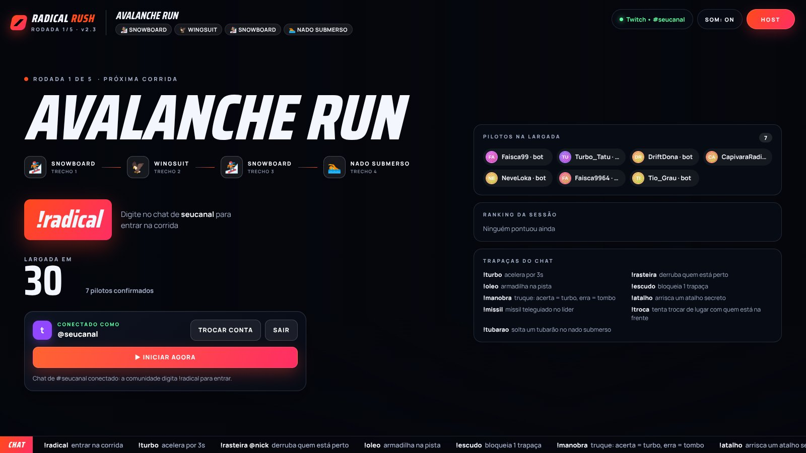

## Como funciona

1. O streamer abre o jogo e clica em **CONECTAR COM TWITCH**. A corrida passa a usar o chat do canal dele.
2. O chat digita `!radical` para entrar. Cada piloto ganha o rosto, as cores do traje e o emblema da foto de perfil.
3. A largada sai quando o cronômetro zera (30 s na primeira rodada, 15 s entre rodadas) ou quando o streamer clica em **▶ INICIAR AGORA**.
4. Durante a corrida, o chat usa as trapaças (`!turbo`, `!rasteira`, `!missil`…). Eventos aleatórios mudam a corrida no meio.
5. Cada rodada dá pontos. No fim do campeonato aparece o campeão, e um novo campeonato começa sozinho ou pelo botão **COMEÇAR NOVO CAMPEONATO**.

## Conta da Twitch

Na tela inicial, clique em **CONECTAR COM TWITCH** e autorize o jogo. A permissão pedida é só de leitura do chat.

- **O login fica lembrado.** Recarregar a página (F5), abrir outra aba ou fechar e reabrir o navegador mantém a conta conectada. Se a autorização da Twitch vencer, o jogo continua lendo o chat do seu canal sem pedir login de novo.
- **Contas independentes.** O jogo roda inteiro no navegador de cada pessoa, sem servidor compartilhado: vários streamers podem usar ao mesmo tempo, cada um com a própria conta. No mesmo navegador, cada aba também pode ficar numa conta diferente e mantém a sua no F5; uma aba nova abre com a última conta conectada.
- **TROCAR CONTA** abre a tela da Twitch para escolher outra conta. **SAIR** desconecta a aba e esquece a conta neste navegador.

## Painel do host

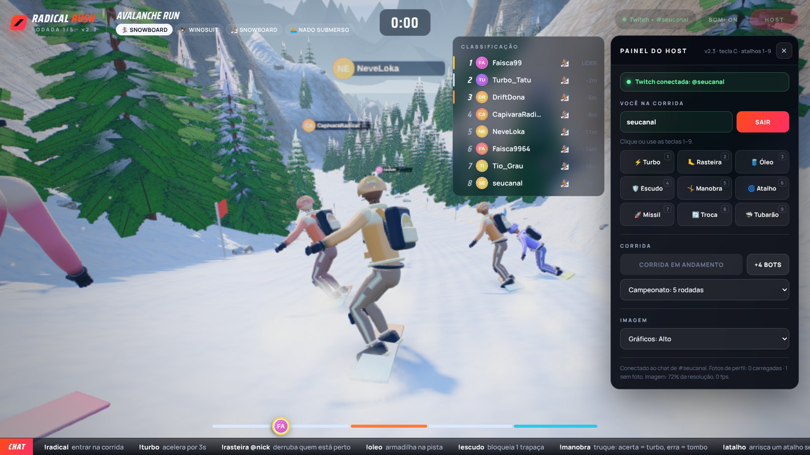

O botão **HOST** (ou a tecla **C**) abre o painel do streamer:

- **Você na corrida:** entrar e sair com a sua conta e usar as trapaças com um clique ou com as teclas 1 a 9.
- **Corrida:** iniciar agora, adicionar 4 bots e escolher o tamanho do campeonato.
- **Imagem:** qualidade gráfica. O rodapé mostra a resolução e os fps atuais.

**Esc** ou o **✕** fecham o painel. Durante a corrida, o botão HOST e o painel ficam translúcidos para não tapar a cena e voltam ao normal quando o mouse passa por cima. Com o painel aberto, a classificação se afasta para não ficar coberta.

## Usar na live (OBS)

1. Adicione uma **Fonte de navegador** no OBS.
2. URL: `https://luanhrq.github.io/radical-rush/`
3. Resolução 1920 × 1080. Marque **Controlar áudio pelo OBS** para a trilha e os efeitos irem para a live.
4. Clique com o botão direito na fonte → **Interagir** e conecte a sua conta Twitch uma vez. O OBS guarda o login.

Sem login, também dá para só ler o chat de um canal com `?channel=seucanal` na URL.

## Comandos do chat

| Comando | Efeito | Recarga |
|---|---|---|
| `!radical` | Entra na corrida | — |
| `!turbo` | Acelera por 3 s | 14 s |
| `!rasteira @nick` | Derruba quem está perto | 20 s |
| `!oleo` | Armadilha na pista: óleo no chão, tempestade no ar, água-viva na água, pedras no paredão | 16 s |
| `!escudo` | Bloqueia uma trapaça | 28 s |
| `!manobra` | Truque: acerta e ganha turbo, erra e cai | 7 s |
| `!atalho` | 40% de chance de pular 6% da pista; senão se perde | 40 s |
| `!missil` | Míssil teleguiado no líder | 35 s |
| `!troca @nick` | 50% de chance de trocar de lugar com quem está à frente | 60 s |
| `!tubarao @nick` | Solta um tubarão em quem está no nado submerso | 40 s |
| `!sair` | Sai do jogo | — |

## Modalidades

| Snowboard | Wingsuit | Mountain bike |
|---|---|---|
| 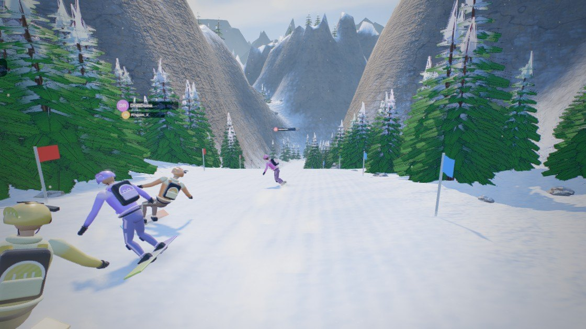 | 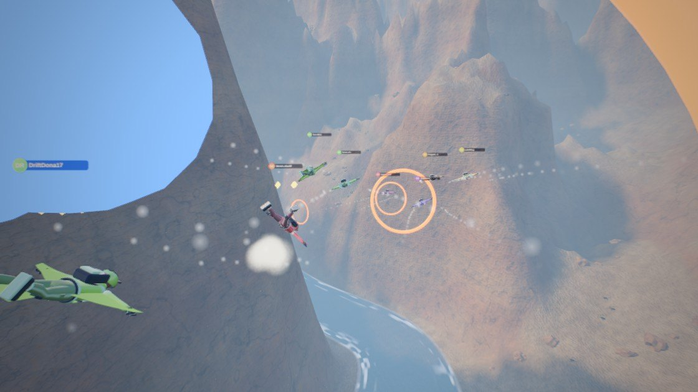 | 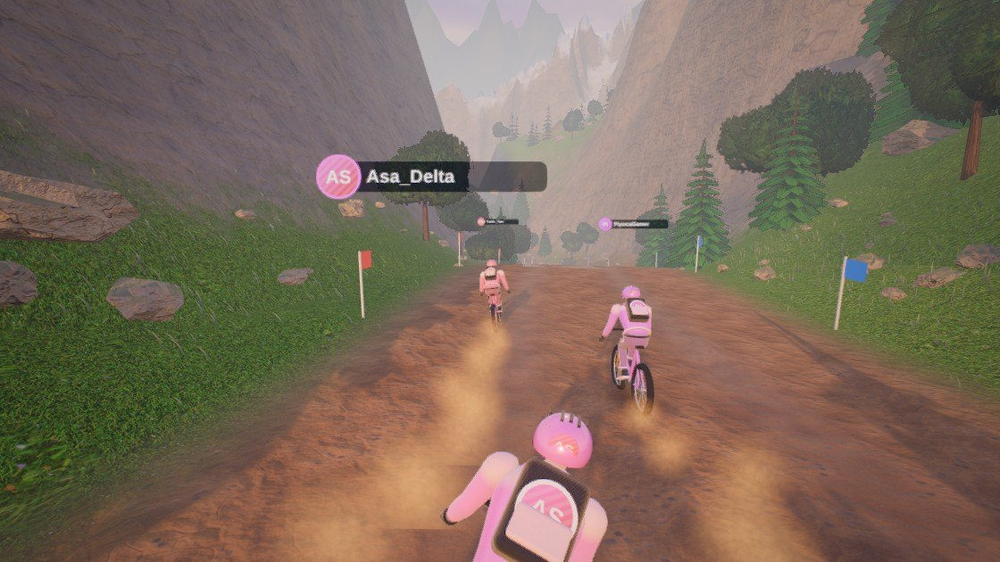 |

| Escalada | Nado submerso | Chegada na praia |
|---|---|---|
| 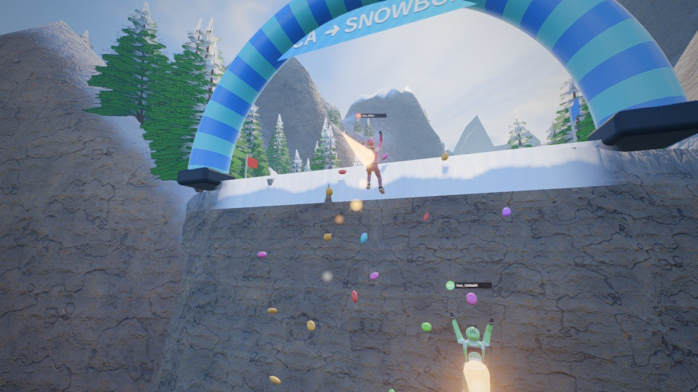 | 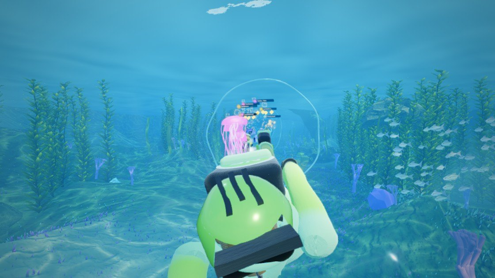 | 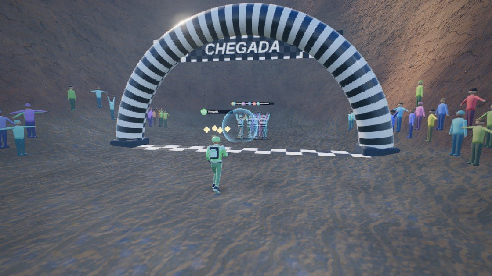 |

| Paraquedas | Remo | Windsurf |
|---|---|---|
| 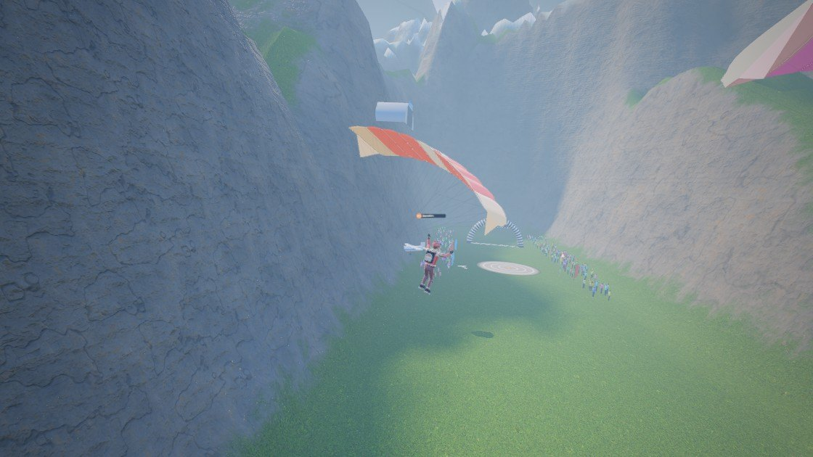 | 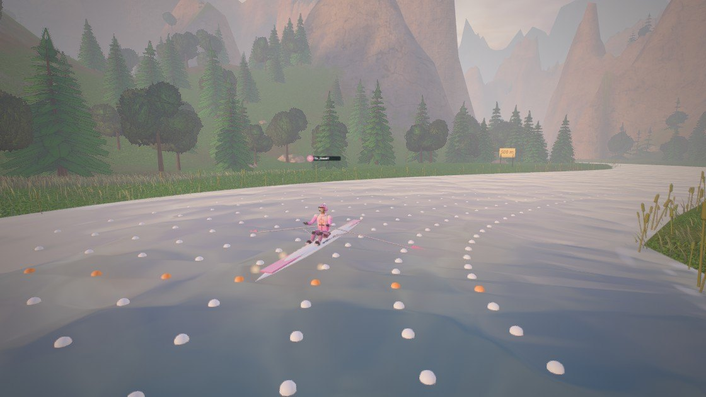 | 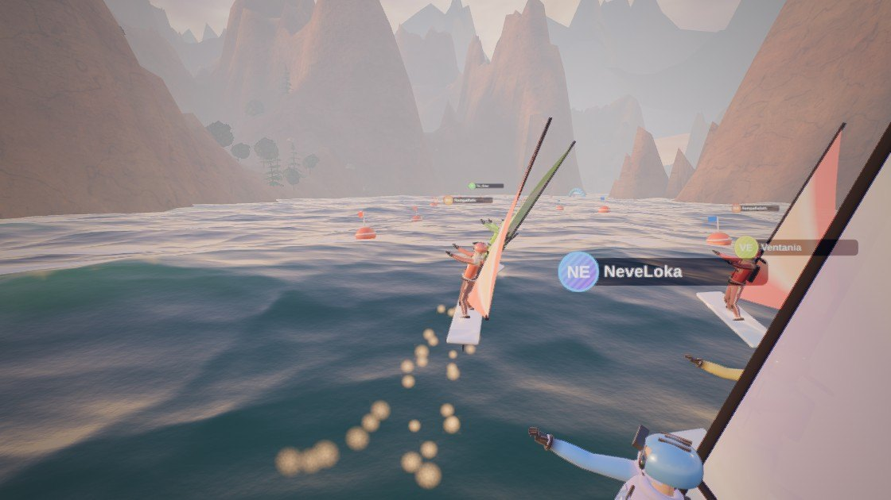 |

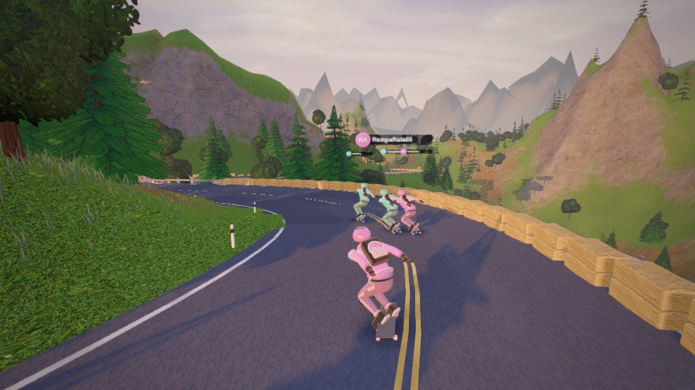

| Modalidade | Como é |
|---|---|
| Snowboard e esqui | Descida na neve entre bandeiras, com curvas em S e joelhos flexionando |
| Mountain bike | Trilha de terra com lombadas e poeira |
| Wingsuit e rocket wing | Voo pelo cânion passando por anéis; o rocket wing tem propulsores |
| Escalada | Paredão de rocha com agarras; quem é atingido escorrega |
| Nado submerso | Túnel de vidro no fundo do mar, com kelp, cardumes que atrasam e tubarões que arrastam para trás. Quando é o último trecho, os nadadores saem da água e correm pela praia até o pórtico de chegada |
| Paraquedas | Salto da plataforma no penhasco (com helicóptero), queda livre e velame retangular de células. Cada piloto voa na sua faixa, pousa no alvo de cascalho e termina correndo, com o velame murchando no chão. Pousar no centro do alvo dá turbo |
| Remo | Regata num rio com raias de boias, pontões numerados, ponte de pedra com público, arquibancada e garagens de barcos. O remador rema de costas para a proa, como numa regata de verdade |
| Windsurf | Mar aberto com boias; a prancha acompanha as ondas e às vezes salta na crista |
| Skate downhill | Descida de longboard numa estrada de serra em curvas, com guard-rail, fardos de feno e placas de curva; os pilotos descem agachados |

Cada modalidade também tem a sua queda: de cara na neve, de lado com a bike e o skate, parafuso no wingsuit, velame fechando no paraquedas, pendurado por um braço na escalada, barco atravessando no remo e vela caindo na água no windsurf.

## Rodadas e campeonato

A primeira rodada é sempre a **Avalanche Run**: snowboard, wingsuit, snowboard e nado submerso até a praia. As seguintes são geradas na hora, com 2 a 4 modalidades, nome, céu e regras próprios, sem repetir as modalidades da rodada anterior. As rodadas 2 a 5 garantem, nessa ordem, skate downhill, paraquedas, remo e windsurf.

O campeonato tem 5 rodadas por padrão. Dá para trocar no painel do host ou com `?rodadas=`; `0` deixa as rodadas sem fim. Cada rodada dá 25, 18, 15, 12, 10, 8, 6, 4, 2 e 1 pontos do 1º ao 10º; quem chega depois disso ganha 1 ponto. No fim, a tela do campeão mostra o pódio e o ranking.

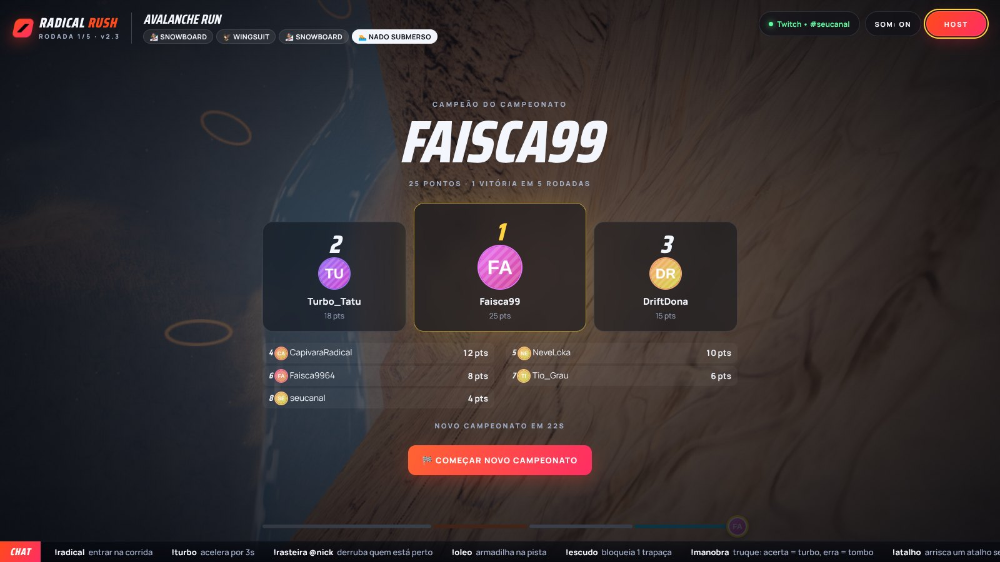

### Regras especiais (sorteadas por rodada)

| Regra | Efeito |
|---|---|
| ❌ Eliminação | A cada 25 s o último colocado é eliminado |
| ⚡ Turbo em dobro | Turbos duram o dobro |
| 🌪️ Caos | Eventos aleatórios a cada ~10 s |
| 🌧️ Tempestade | Céu fechado e mais neblina |
| 🌙 Gravidade baixa | Saltos bem mais altos (ondas, manobras, quedas) |

Eventos aleatórios no meio da corrida: vento a favor, avalanche, turbulência ou deslizamento, neblina densa, chuva de turbo, terreno instável e reviravolta.

## Câmera do espectador

| Ação | Controle |
|---|---|
| Trocar de piloto | Scroll do mouse, setas ← →, ou clique no nome na classificação |
| Girar a câmera em volta do piloto | Arrastar com o mouse |
| Aproximar / afastar | Shift + scroll |
| Voltar para a câmera automática | Duplo clique ou tecla A |

## Parâmetros da URL

| Parâmetro | Exemplo | O que faz |
|---|---|---|
| `channel` | `?channel=seucanal` | Lê o chat desse canal sem login (só quando nenhuma conta está conectada) |
| `bots` | `&bots=4` | Adiciona pilotos bot para encher a largada |
| `lobby` | `&lobby=30` | Segundos de espera na primeira rodada |
| `lobbynext` | `&lobbynext=15` | Segundos de espera entre rodadas |
| `max` | `&max=40` | Limite de pilotos |
| `quality` | `&quality=medium` | `ultra`, `high`, `medium` ou `low` |
| `rodadas` | `&rodadas=5` | Tamanho do campeonato (3, 5, 7, 10…). `0` = rodadas sem fim |
| `demo` | `?demo` | Modo teste sem Twitch, com bots |
| `segs` | `?demo&segs=bike,paraquedas&sky=sunset` | Monta uma rodada fixa para testar trechos. Modalidades: `snowboard`, `ski`, `bike`, `wingsuit`, `rocket`, `escalada`, `nado`, `paraquedas`, `remo`, `windsurf`, `skate`. Céus: `day`, `golden`, `sunset`, `crisp` |

## Qualidade gráfica

| Qualidade | Para quem |
|---|---|
| Ultra | Placas de vídeo fortes. Liga a oclusão ambiente (sombras de contato) em resolução cheia |
| Alto | Padrão. Boa imagem na maioria das placas de vídeo dedicadas |
| Médio | Notebooks e placas integradas |
| Baixo | Máquinas fracas ou quando o OBS já está pesado |

A resolução se ajusta sozinha para manter a fluidez, sem descer abaixo de 72% no Alto. Se o rodapé do painel do host mostrar menos de 30 fps, baixe um nível. Precisa de um navegador com WebGL 2 (Chrome, Edge ou Firefox atuais, ou o OBS 28 em diante). A versão aparece no canto superior esquerdo (ex.: `RODADA 1/5 · v2.3`); se aparecer uma versão antiga, recarregue com Ctrl+Shift+R.

## Tecnologia

- **Tudo gerado por código.** Terreno, pistas, cenários, árvores, personagens, público, céu, mar e trilha sonora são criados a cada rodada, sem modelos, texturas ou arquivos de áudio externos. [three.js](https://threejs.org) r160 vem da CDN jsDelivr.
- **Gráficos.** Materiais PBR iluminados pelo céu, terreno com texturas triplanares de alta resolução (rocha, grama, neve, areia) e detalhe extra de perto, sombras das montanhas e de nuvens, neblina de altura com cor por céu, grama densa e árvores com vento. Pós-processamento com MSAA, FXAA, oclusão ambiente GTAO (Ultra), bloom, raios de sol, tonemapping AgX e correção de cor.
- **Água.** O mar e o rio usam ondas de Gerstner na geometria e, por pixel, ondas direcionais com cristas afiadas que se desfazem com a distância para não cintilar. Debaixo d'água, a luz é absorvida por cor, com feixes de luz, cáusticas e floresta de kelp. Tubarões, peixes, arraias e águas-vivas têm corpo, nadadeiras, pintura e nado próprios.
- **Personagens.** O corpo é uma malha contínua com esqueleto (skinning), com traje em recortes de cor, luvas com dedos e cabeça com maxilar. As cores saem da foto de perfil da Twitch, e a foto vira o rosto e aparece no peito, nas costas e no capacete (fotos via [decapi.me](https://decapi.me) e [unavatar.io](https://unavatar.io); sem foto, o piloto ganha um avatar gerado).
- **Movimento.** Curvas em S contínuas por modalidade, corpo inclinando com a força da curva, quedas em fases e comemoração ao cruzar a chegada.
- **Som.** Trilha e efeitos sintetizados em tempo real com Web Audio, com um tema por ambiente: montanha, trilha e skate, céu, paredão, aquático, lobby e campeão. A música troca sozinha quando o piloto em foco muda de ambiente.
- **Twitch.** Login OAuth só com permissão de leitura do chat e leitura pelo IRC da Twitch via WebSocket. O token fica guardado só no navegador de quem conectou.

## Código

```
src/
  template.html   HTML da página (HUD, tela inicial, resultado, painel do host)
  style.css       estilos
  js/             o jogo, dividido por assunto (00-core.js … 27-host-ui.js)
build.mjs         junta tudo em index.html
```

Os arquivos de `src/js` são concatenados na ordem do nome dentro de um único `<script type="module">`, então compartilham o mesmo escopo (sem import/export entre eles), no mesmo esquema do abyssal-garden.

| Arquivo | Conteúdo |
|---|---|
| `00-core.js` | Importações, configuração e presets de qualidade |
| `01-shaders.js` | GLSL compartilhado: céu, neblina, ondas, luz subaquática |
| `02-render.js` | Renderizador, pós-processamento e céus |
| `03-textures.js` | Texturas procedurais |
| `04-particles.js` | Partículas |
| `05-data.js` | Modalidades, rodadas, regras e comandos |
| `06-world.js` | Pista, relevo e materiais do terreno |
| `07-venues.js` | Cenários de cada modalidade (estrada de serra, área de pouso, regata, paredão, túnel) |
| `08-ocean.js` | Mar e vida marinha |
| `09-scenery.js` | Pórticos, vegetação, rochas, grama e público |
| `10-riders.js` | Personagens, equipamentos e poses |
| `11-racers.js` | Física, curvas, quedas e lógica dos pilotos |
| `12-commands.js` | Trapaças do chat |
| `13-events.js` | Eventos aleatórios |
| `14-state.js` | Estados do jogo: tela inicial, corrida, resultado |
| `15-camera.js` | Diretor de câmera e câmera do espectador |
| `16-ui.js` | HUD, tela inicial e painel |
| `17-twitch.js` | Login da Twitch e chat |
| `18-bots.js` | Bots |
| `19-audio.js` | Trilha e efeitos |
| `20-loop.js` | Laço principal |
| `21-boot.js` | Inicialização |
| `22-streamer-controls.js` | Cartão do streamer na tela inicial, iniciar agora, novo campeonato |
| `23-twitch-session.js` | Canal conectado na tela inicial e no painel |
| `24-host-panel.js` | Estado da conexão no painel do host |
| `25-startup-diagnostics.js` | Mostra o erro na tela se a inicialização falhar |
| `26-host-twitch-controls.js` | Entrar na corrida e trapaças com a conta conectada |
| `27-host-ui.js` | Painel do host translúcido na corrida, fechar, iniciar |

Para gerar o `index.html` depois de editar:

```bash
node build.mjs
```

O workflow do GitHub Pages também roda o build antes de publicar.

## Créditos

As técnicas do mar (ondas, brilho do sol, crista iluminada por trás, espuma, tonemapping AgX) foram inspiradas em [noniv/web-ocean](https://github.com/noniv/web-ocean), e o visual subaquático (absorção de luz por cor, névoa que clareia perto da superfície, feixes de luz, cáusticas, floresta de kelp, arraias e bolhas) em [Noniv/abyssal-garden](https://github.com/Noniv/abyssal-garden). Os dois são MIT; a implementação aqui é própria, em WebGL.
