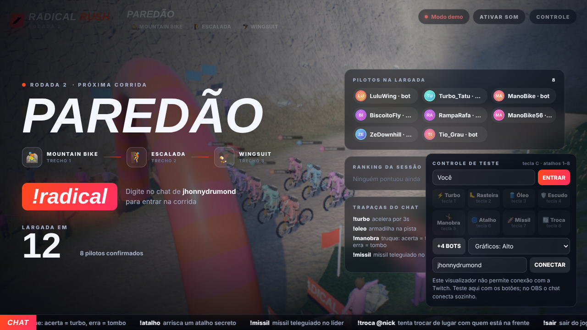
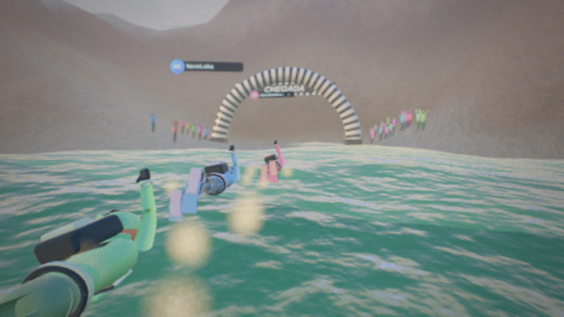

# Radical Rush

Corrida 3D de esportes radicais controlada pelo chat da Twitch. Quem digita `!radical` no chat entra na corrida com a própria foto de perfil, e o chat usa trapaças para atrasar os rivais ou ganhar vantagem.

**Jogar no navegador:** https://luanhrq.github.io/radical-rush/

| Escalada | Nado submerso | Chegada na praia |
|---|---|---|
|  |  |  |

## Usar na live (OBS)

1. Adicione uma **Fonte de navegador** no OBS.
2. URL: `https://luanhrq.github.io/radical-rush/?channel=jhonnydrumond`
3. Resolução 1920 × 1080. Marque "Controlar áudio pelo OBS" para a trilha e os efeitos irem para a live.

O jogo conecta sozinho ao chat (leitura anônima, sem login) e começa a rodada quando o primeiro piloto entra.

### Parâmetros da URL

| Parâmetro | Exemplo | O que faz |
|---|---|---|
| `channel` | `?channel=jhonnydrumond` | Canal da Twitch (padrão: jhonnydrumond) |
| `bots` | `&bots=4` | Adiciona pilotos bot para encher a largada |
| `lobby` | `&lobby=30` | Segundos de espera na primeira rodada |
| `lobbynext` | `&lobbynext=15` | Segundos de espera entre rodadas |
| `max` | `&max=40` | Limite de pilotos |
| `quality` | `&quality=medium` | `ultra`, `high`, `medium` ou `low` |
| `demo` | `?demo` | Modo teste sem Twitch, com bots |

A tecla **C** abre o painel de teste: entrar como piloto, usar as trapaças (teclas 1 a 9), adicionar bots, trocar a qualidade gráfica e o canal.

## Comandos do chat

| Comando | Efeito | Recarga |
|---|---|---|
| `!radical` | Entra na corrida | — |
| `!turbo` | Acelera por 3 s | 14 s |
| `!rasteira @nick` | Derruba quem está perto | 20 s |
| `!oleo` | Armadilha na pista (vira tempestade no ar, água-viva na água, pedras no paredão) | 16 s |
| `!escudo` | Bloqueia uma trapaça | 28 s |
| `!manobra` | Truque: acerta e ganha turbo, erra e cai | 7 s |
| `!atalho` | 40% de chance de pular 6% da pista; senão se perde | 40 s |
| `!missil` | Míssil teleguiado no líder | 35 s |
| `!troca @nick` | 50% de chance de trocar de lugar com quem está à frente | 60 s |
| `!tubarao @nick` | Solta um tubarão em quem está no nado submerso | 40 s |
| `!sair` | Sai do jogo | — |

## Modalidades e rodadas

Cada rodada mistura modalidades e troca de esporte no meio do percurso: snowboard, esqui, mountain bike, wingsuit, rocket wing, **escalada** num paredão de rocha e **nado submerso** dentro de um túnel de vidro, com cardumes que atrasam e tubarões que pegam um nadador e o arrastam para trás. As rodadas que terminam no mar chegam numa praia.

Eventos aleatórios no meio da corrida: vento a favor, avalanche ou deslizamento, neblina, chuva de turbo, terreno instável e reviravolta.

## Tecnologia

- Um único `index.html`, sem build. [three.js](https://threejs.org) r160 é carregado da CDN jsDelivr.
- Terreno, árvores, personagens, plateia, céu e mar são gerados por código a cada rodada; não há modelos nem texturas externas.
- Renderização: materiais PBR com iluminação do céu, terreno com texturas triplanares e normal maps, sombras das montanhas e oclusão pré-calculadas, sombras de nuvens, neblina de altura com brilho do sol, mar com ondas Gerstner, reflexo do céu, brilho do sol, espuma e espuma na arrebentação, cáusticas e neblina subaquática, grama densa e árvores com vento.
- Pós-processamento: MSAA, bloom, raios de sol, desfoque radial no turbo, tonemapping AgX e correção de cor. A resolução se ajusta sozinha para manter a fluidez.
- Trilha sonora e efeitos sintetizados em tempo real com Web Audio (nenhum arquivo de áudio). A trilha muda entre lobby, contagem, corrida e resultado, e cada rodada tem andamento e tom próprios.
- Fotos de perfil via [decapi.me](https://decapi.me) e [unavatar.io](https://unavatar.io); se não carregarem, o piloto recebe um avatar gerado.

As técnicas do mar (ondas, brilho do sol, crista iluminada por trás, espuma, tonemapping AgX) foram inspiradas na descrição do projeto [noniv/web-ocean](https://github.com/noniv/web-ocean) (MIT). A implementação aqui é própria, em WebGL.
