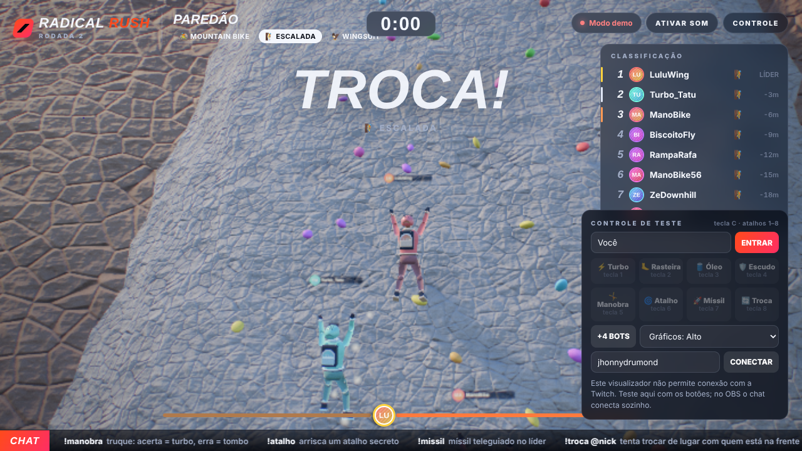
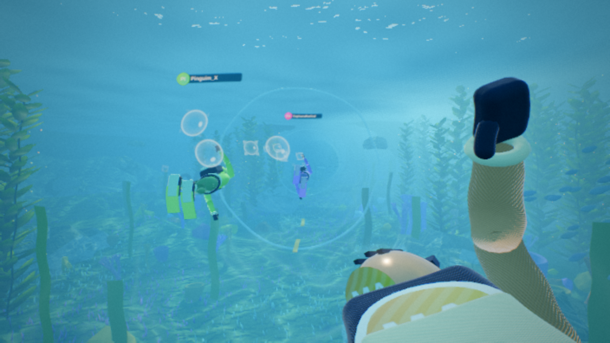
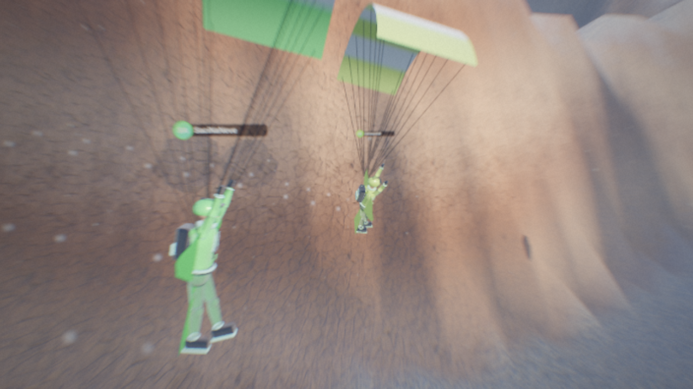
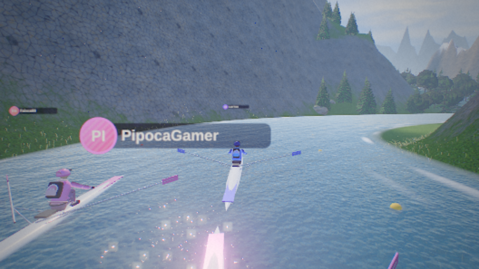
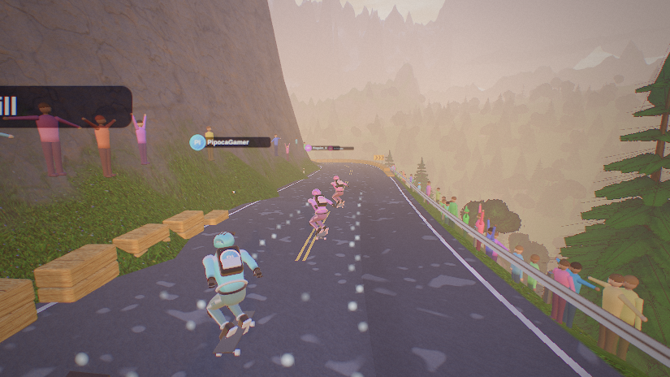
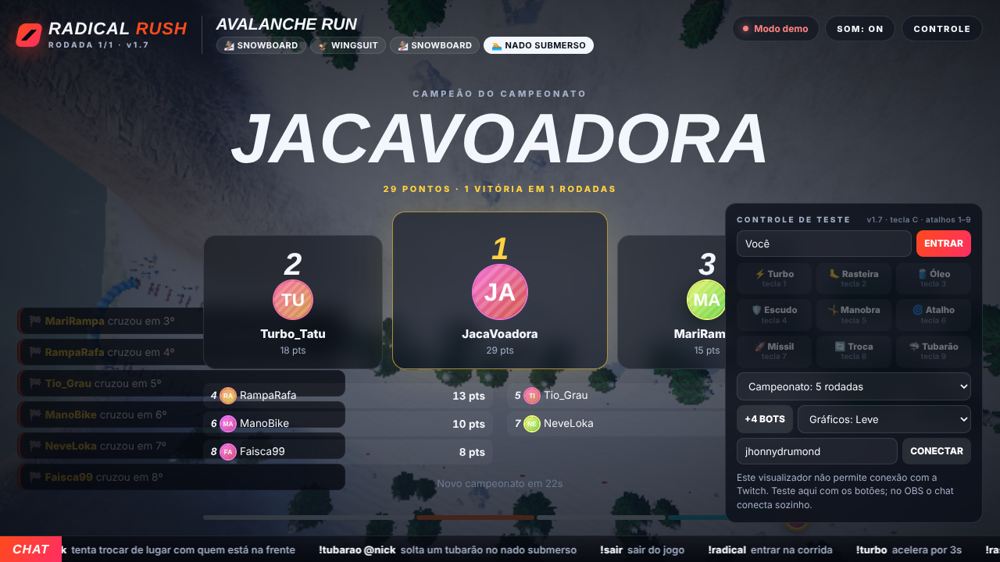

# Radical Rush

Corrida 3D de esportes radicais controlada pelo chat da Twitch. Quem digita `!radical` no chat entra na corrida com a própria foto de perfil, e o chat usa trapaças para atrasar os rivais ou ganhar vantagem.

**Jogar no navegador:** https://luanhrq.github.io/radical-rush/


| Escalada | Nado submerso | Chegada na praia |
|---|---|---|
|  |  |  |

| Paraquedas | Remo | Windsurf |
|---|---|---|
|  |  |  |





## Usar na live (OBS)

1. Adicione uma **Fonte de navegador** no OBS.
2. URL: `https://luanhrq.github.io/radical-rush/?channel=jhonnydrumond`
3. Resolução 1920 × 1080. Marque "Controlar áudio pelo OBS" para a trilha e os efeitos irem para a live.

O jogo conecta sozinho ao chat (leitura anônima, sem login) e começa a rodada quando o primeiro piloto entra.

### Parâmetros da URL

| Parâmetro | Exemplo | O que faz |
|---|---|---|
| `channel` | `?channel=jhonnydrumond` | Canal da Twitch (padrão: jhonnydrumond) |
| `bots` | `&bots=4` | Adiciona pilotos bot para encher a largada |
| `lobby` | `&lobby=30` | Segundos de espera na primeira rodada |
| `lobbynext` | `&lobbynext=15` | Segundos de espera entre rodadas |
| `max` | `&max=40` | Limite de pilotos |
| `quality` | `&quality=medium` | `ultra`, `high`, `medium` ou `low` |
| `rodadas` | `&rodadas=5` | Tamanho do campeonato (3, 5, 7, 10…). `0` = rodadas sem fim |
| `demo` | `?demo` | Modo teste sem Twitch, com bots |

### Câmera do espectador

| Ação | Controle |
|---|---|
| Trocar de piloto | Scroll do mouse, setas ← →, ou clique no nome na classificação |
| Girar a câmera em volta do piloto | Arrastar com o mouse |
| Aproximar / afastar | Shift + scroll |
| Voltar para a câmera automática | Duplo clique ou tecla A |

A tecla **C** abre o painel de teste: entrar como piloto, usar as trapaças (teclas 1 a 9), adicionar bots, trocar a qualidade gráfica e o canal.

## Comandos do chat

| Comando | Efeito | Recarga |
|---|---|---|
| `!radical` | Entra na corrida | — |
| `!turbo` | Acelera por 3 s | 14 s |
| `!rasteira @nick` | Derruba quem está perto | 20 s |
| `!oleo` | Armadilha na pista (vira tempestade no ar, água-viva na água, pedras no paredão) | 16 s |
| `!escudo` | Bloqueia uma trapaça | 28 s |
| `!manobra` | Truque: acerta e ganha turbo, erra e cai | 7 s |
| `!atalho` | 40% de chance de pular 6% da pista; senão se perde | 40 s |
| `!missil` | Míssil teleguiado no líder | 35 s |
| `!troca @nick` | 50% de chance de trocar de lugar com quem está à frente | 60 s |
| `!tubarao @nick` | Solta um tubarão em quem está no nado submerso | 40 s |
| `!sair` | Sai do jogo | — |

## Campeonato

O jogo roda campeonatos (padrão: 5 rodadas; dá para trocar no painel **C** ou com `?rodadas=`). Cada rodada dá pontos (25, 18, 15, 12, 10, 8, 6, 4, 2, 1), e no fim aparece a tela do **campeão**, quem somou mais pontos, com pódio e ranking. Depois começa um campeonato novo.

## Modalidades e rodadas

A primeira rodada é sempre a Avalanche Run (snowboard, wingsuit, snowboard e nado submerso até a praia). As seguintes são **geradas na hora**: 2 a 4 modalidades sorteadas, nome, céu e regras diferentes, evitando repetir as modalidades da rodada anterior.

| Modalidade | Como funciona |
|---|---|
| Snowboard, esqui | Descida na neve |
| Mountain bike | Trilha de terra com lombadas |
| Wingsuit, rocket wing | Voo pelo cânion, passando por anéis |
| Escalada | Paredão de rocha com agarras; quem é atingido escorrega |
| Nado submerso | Túnel de vidro no mar, com cardumes que atrasam e tubarões que arrastam para trás. Quando é o último trecho, os nadadores saem da água e correm pela praia até o pórtico de chegada |
| **Paraquedas** | Salto da plataforma no penhasco (com helicóptero), queda livre entre nuvens, abertura do velame retangular de células (com slider e linhas), curvas inclinando o velame, arredondamento no pouso e área de pouso com alvo de cascalho, biruta, hangar e avião. Pousar no centro do alvo dá turbo |
| **Remo** | Regata num rio com raias de boias, pontões numerados, torre de largada, ponte de pedra em arco com público, arquibancada coberta, garagens de barcos e placas de distância. Cada barco fica na sua raia e o remador rema de costas para a proa, como numa regata de verdade: desliza no carrinho e as pás deixam círculos na água |
| **Windsurf** | Mar aberto com boias; a prancha acompanha as ondas e às vezes salta na crista |
| **Skate downhill** | Descida de longboard numa estrada de serra em curvas, com guard-rail, fardos de feno na parte de fora das curvas, placas de curva e paredão de rocha. Os pilotos descem agachados (tuck) |

### Regras especiais (sorteadas por rodada)

| Regra | Efeito |
|---|---|
| ❌ Eliminação | A cada 25 s o último colocado é eliminado |
| ⚡ Turbo em dobro | Turbos duram o dobro |
| 🌪️ Caos | Eventos aleatórios a cada ~10 s |
| 🌧️ Tempestade | Céu fechado e mais neblina |
| 🌙 Gravidade baixa | Saltos muito mais altos (cama elástica, ondas, manobras) |

Eventos aleatórios no meio da corrida: vento a favor, avalanche ou deslizamento, neblina, chuva de turbo, terreno instável e reviravolta.

## Tecnologia

- O jogo publicado é um único `index.html`, gerado a partir dos módulos em `src/` (veja **Código** abaixo). A versão aparece no canto superior esquerdo (ex.: `RODADA 1 · v1.9`); se aparecer uma versão antiga, recarregue com Ctrl+Shift+R. [three.js](https://threejs.org) r160 é carregado da CDN jsDelivr.
- Terreno, árvores, personagens, plateia, céu e mar são gerados por código a cada rodada; não há modelos nem texturas externas.
- Renderização: materiais PBR com iluminação do céu, terreno com texturas triplanares e normal maps, sombras das montanhas e oclusão pré-calculadas, sombras de nuvens, neblina de altura com brilho do sol, mar com ondas Gerstner, reflexo do céu, brilho do sol, espuma e espuma na arrebentação, cáusticas e neblina subaquática, grama densa e árvores com vento.
- Texturas geradas em alta resolução (1024 px) com cor e relevo próprios para rocha (fissuras, estratos, líquen), grama (dezenas de milhares de folhas), neve e terra, misturadas em duas escalas para não repetir.
- Pós-processamento: MSAA, oclusão ambiente GTAO em resolução cheia (sombras de contato; qualidade Ultra), bloom, raios de sol, desfoque radial no turbo, tonemapping AgX e correção de cor. A resolução se ajusta sozinha para manter a fluidez.
- Trilha sonora e efeitos sintetizados em tempo real com Web Audio (nenhum arquivo de áudio). Cada ambiente tem um tema original no estilo de jogo de plataforma: montanha nevada (sinos e baixo saltitante), trilha radical, skate e remo (rápida, com baixo marcado), céu/wingsuit/paraquedas (a mais rápida, com arpejos), paredão (tensa, com tambores), aquático (calmo, em compasso ternário, com vibrafone e marimba), além de lobby, contagem e resultado/campeão. A música troca sozinha quando o piloto em foco muda de ambiente.
- O corpo do piloto é uma malha contínua com esqueleto (skinning): tronco, braços e pernas se dobram sem emendas em ombros, cotovelos, quadris e joelhos, com traje em recortes de cor, luvas com dedos, joelheiras e cabeça com maxilar e queixo.
- O piloto é montado a partir da foto de perfil da Twitch: as cores do traje, do capacete e do equipamento saem das cores principais da foto, a foto vira o rosto do personagem e aparece no peito, nas costas e no capacete. Fotos de perfil via [decapi.me](https://decapi.me) e [unavatar.io](https://unavatar.io); se não carregarem, o piloto recebe um avatar gerado.

## Código

```
src/
  template.html   HTML da página (HUD, lobby, resultado)
  style.css       estilos
  js/00-core.js … js/21-boot.js   o jogo, dividido por assunto
build.mjs         junta tudo em index.html
```

Os arquivos de `src/js` são concatenados na ordem do nome dentro de um único `<script type="module">`, então compartilham o mesmo escopo (sem import/export entre eles), no mesmo esquema do abyssal-garden. Principais módulos: `06-world.js` (pista e relevo), `07-venues.js` (cenários de cada modalidade: estrada de serra, área de pouso, regata, paredão, túnel), `08-ocean.js` (mar e vida marinha), `09-scenery.js` (vegetação, rochas, grama e público), `10-riders.js` (personagens e poses), `11-racers.js` (física e lógica dos pilotos), `19-audio.js` (trilha e efeitos), `17-twitch.js` (chat).

Para gerar o `index.html` depois de editar:

```bash
node build.mjs
```

O workflow do GitHub Pages também roda o build antes de publicar.

As técnicas do mar (ondas, brilho do sol, crista iluminada por trás, espuma, tonemapping AgX) foram inspiradas em [noniv/web-ocean](https://github.com/noniv/web-ocean), e o visual subaquático (absorção de luz por cor, névoa que clareia perto da superfície, feixes de luz, cáusticas projetadas pelo sol, floresta de kelp, arraias e bolhas) em [Noniv/abyssal-garden](https://github.com/Noniv/abyssal-garden). Os dois são MIT; a implementação aqui é própria, em WebGL.
